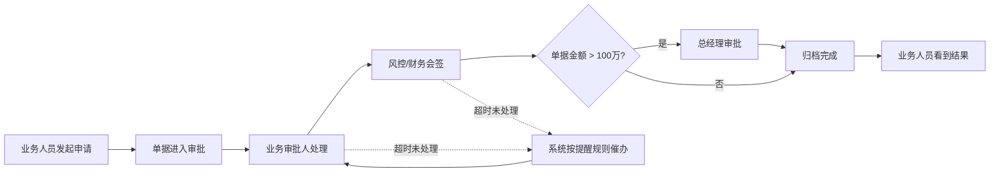
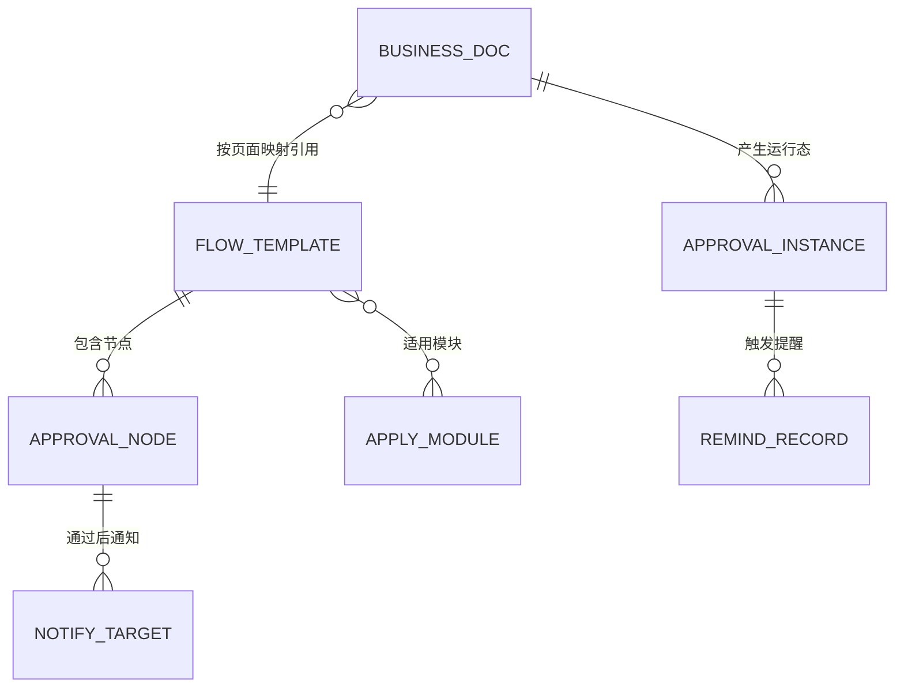
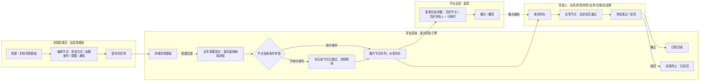

# 02.17–02.19 审批管理 · 产品需求文档（PRD）

> **模块**：数字供应链 → 审批管理
> **覆盖页面**：审批流程配置（`approval-flow-list.html`）、流程编排画布（`approval-flow-editor.html`）、审批流程监控（`approval-monitor.html`）
> **文档版本**：v1.0.0（2026-10-26，首次按 8 章线性骨架重写）
> **状态**：待评审
> **依据**：原型现状（编排页 v1.11.0 / 监控页 v1.6.0 / 配置页 v1.6.0 / 审批引擎 v1.1.0）、117 个业务页面实测接入情况
> **阅读对象**：产品、研发、测试、UI、业务方

---

## 1. 一页结论

### 1.1 问题

当前 14 个业务页面的审批链路是**写死在页面里**的：每个页面各写一套审批时间线，节点、审批人、层级都固化在代码中。由此产生三个具体问题：

| 问题 | 现状表现 | 后果 |
|---|---|---|
| 改一次审批规则要改 14 个页面 | 审批节点硬编码在各页面 | 调整层级 = 一次跨 14 页的改造 + 发版，周期长、风险高 |
| 各业务审批口径无法统一 | 合同、回款、立项各写一套 | 同类单据在不同模块审批标准不一致，业务方无法横向对比 |
| 大额单据审批层级不够 | 小额与高额走同一条链路 | 金额风险高的单据没有自动升级审批层级，风险敞口靠人工把关 |

### 1.2 方案

新增**「审批管理」**模块（3 个页面 + 1 套通用审批引擎），把审批链路从"代码"变成"配置"：

- **审批流程配置**：管理审批流程模板（增删改查 / 复制 / 启停）
- **流程编排画布**：两步向导编排节点（串行审批、并行会签、金额触发条件、提醒规则、审批通知）
- **审批流程监控**：查看在途单据卡在哪一步、当前审批人是谁、条件分支求值明细、提醒记录
- **通用审批引擎**：一份配置同时驱动"配置页、监控页、14 个业务页面"，三处时间线完全一致

### 1.3 效果

- 调整审批规则：改配置即可，业务页面零改动
- 大额单据：金额超过阈值时自动追加总经理审批层级
- 审批可观测：每条在途单据都能查到当前节点与当前审批人，可催办
- 效果衡量以系统运行报表为准，本文档不预设业务数值

### 1.4 本期边界

**做**：3 个审批管理页面、通用审批引擎、3 套内置模板、14 个业务页面接入、节点属性（审批方式 / 金额条件 / 提醒规则 / 审批通知）。

**不做**：不做线上资金扣划与放款动作（资金流转仍为线下完成、系统登记凭证）；不做跨系统消息网关对接（催办/撤回当前为演示交互）；不做多组织/多租户的流程隔离；不做流程版本回溯与历史实例重算。

---

## 2. 背景与目标

### 2.1 业务目标

| # | 目标 | 可衡量的口径 |
|---|---|---|
| G1 | 审批规则可配置，业务方不依赖研发即可调整审批链路 | 一次审批层级调整所需交付物 = 一次流程配置变更，不涉及页面代码改动 |
| G2 | 大额单据自动升级审批层级 | 单据金额 > 100 万的申请，审批链路中必定出现"总经理审批"节点 |
| G3 | 审批在途状态可查 | 在途单据可查到「当前节点 + 当前审批人 + 已耗时 + 提醒规则」，覆盖率 100% |
| G4 | 审批动作有留痕 | 审批通过后的知会动作必定产生一条站内信记录（站内信不可关闭） |

> 上述口径的达成情况以上线后系统运行报表为准；本 PRD 不预设运行数值。

### 2.2 为什么是现在

- 合同管理、付款管理、退款管理、追保函管理四类资金与担保类模块已全部接入同一套高风险审批链路，链路一旦需要调整，影响面已是 14 个页面
- 资金类单据的审批时效直接影响业务周转，缺少"卡在哪、谁在审"的可见性时，只能靠人工询问
- 业务模块仍在持续新增（回款管理于 v1.11.0 进入应用模块字典），若继续各页硬编码，新增模块的成本只会更高

### 2.3 本期不做（与 §1.4 呼应）

| 不做的事 | 原因 |
|---|---|
| 审批通过后自动执行放款/付款动作 | 资金流转为线下完成 + 系统登记凭证，审批只做链路判断 |
| 催办、撤回的真实发送与落库 | 当前为演示交互，真实版本需接消息网关并补撤回权限校验 |
| 流程模板的历史版本与实例重算 | 本期不做配置版本管理，改配置即对后续新单据生效 |
| 条件分支支持金额以外的字段 | 本期条件只支持"单据金额"，收敛为每节点最多 1 条金额条件 |

---

## 3. 角色与用户需求

### 3.1 角色清单

| 角色 | 所属部门 | 在本模块的动作 | 影响的单据类型 |
|---|---|---|---|
| 平台管理员 | 运营管理部 | 建/改/复制/启停/删流程模板，编排节点，查看监控 | 全部应用模块 |
| 业务审批人 | 业务部 | 在业务单据详情页查看审批进度、审批通过/驳回 | 合同、付款、货转、放货等 |
| 风控审批人 | 风控部 | 会签节点逐人审批 | 合同、付款、退款、追保函、准入 |
| 财务审批人 | 财务部 | 审批/会签 | 合同、付款、退款、货转 |
| 合规审查 | 法务部 | 合规审查节点审批 | 合同、追保函 |
| 放货审批人 | 仓储部 | 放货审批节点审批 | 放货管理 |
| 总经理 | 总经理 | 大额单据最终审批 | 金额 > 100 万的申请 |
| 平台运营 | 运营管理部 | 看卡单分布、催办、撤回 | 全部应用模块 |

### 3.2 各角色需求（按"我要…以便…"句式）

| 角色 | 需求 |
|---|---|
| 平台管理员 | 我要能复制一份现有模板再改，以便不动正在跑的流程就能试新的审批链路 |
| 平台管理员 | 我要在同一个节点上选串行或多人会签，以便不同业务用同一套节点模型 |
| 平台管理员 | 我要给节点挂金额条件，以便大额单据自动多走一级审批 |
| 平台管理员 | 我要指定审批通过后通知谁、以什么渠道通知，以便相关方能及时知会 |
| 业务审批人 | 我要在单据详情页看到完整审批时间线和我的待办节点，以便判断该由我处理 |
| 会签审批人 | 我要看到同节点还有谁没审，以便知道自己不是唯一责任人 |
| 总经理 | 我要只处理需要我这一级的大额单据，以便不被小额单据打扰 |
| 平台运营 | 我要按模块和流程筛选在途单据，以便定位积压集中在哪个环节 |
| 平台运营 | 我要一键催办卡住的单据，以便缩短在途时长 |

### 3.3 旅程（体验路径）



> 旅程中的每一个"等待"节点，在监控页都有对应的可见位置（当前节点、当前审批人、已耗时、提醒记录）。

---

## 4. 功能结构与范围

### 4.1 功能结构

```
审批管理
├── 审批流程配置（模板列表）
│   ├── 筛选：流程名称 / 流程状态 / 应用模块（实时过滤 + 条件 chip + 一键清除）
│   ├── 列表：流程名称 / 状态 / 节点数 / 流程说明 / 应用模块 / 最后修改 / 操作
│   ├── 操作：新建 / 编排 / 复制 / 启用停用 / 删除 / 数据导出
│   └── 分页：每页 10 / 20 / 50 条
├── 流程编排画布（两步向导）
│   ├── 步骤 1 基础信息：流程名称 / 流程说明 / 流程状态 / 应用模块（9 项多选）
│   ├── 步骤 2 流程设计
│   │   ├── 画布：节点纵向单列，连接线上「+」插入节点，节点上下移动/删除
│   │   ├── 节点属性抽屉：名称 / 审批方式 / 审批人员 / 触发条件 / 提醒规则 / 审批通知 / 通知类型 / 节点说明
│   │   ├── 流程图预览（弹窗）：节点时间线 + 触发条件求值明细
│   │   └── 保存 / 未保存标记 / 返回二次确认
│   └── 校验：名称必填、应用模块至少 1 个、发起与归档节点不可删、会签至少 1 人、串行必须选审批人
└── 审批流程监控
    ├── KPI：实例总数 / 审批中 / 已通过 / 已触发审批提醒（随筛选联动重算）
    ├── 状态 Tab：全部 / 审批中 / 已通过 / 已驳回 / 已撤回
    ├── 筛选：应用模块（9 项）/ 引用流程（3 项）
    ├── 实例列表：单据编号 / 应用模块 / 引用流程 / 单据金额 / 发起人 / 当前节点 / 当前审批人 / 状态 / 提交时间 / 操作
    ├── 审批提醒记录：单据 / 模块 / 卡在节点 / 提醒对象 / 阈值 / 渠道 / 触发时间 / 送达状态
    └── 详情抽屉：单据摘要 + 审批时间线 + 条件分支求值明细 + 催办 / 撤回
```

### 4.2 支撑能力（引擎，非独立页面）

| 能力 | 说明 |
|---|---|
| 流程模板存取 | 新建 / 读取 / 更新 / 删除 / 复制；复制时状态置"草稿"、节点标识重映射 |
| 节点展开 | 按单据实际数据把流程模板展开为本次要走的节点序列 |
| 条件求值 | 按单据金额判断节点是否执行；不满足则该节点标记"已跳过"，流程继续 |
| 时间线渲染 | 一套渲染逻辑，供业务页面、监控抽屉、流程预览三处复用 |
| 人员与环节字典 | 16 人平台人员目录 + 7 个审批环节，默认配色与默认审批人由环节带出 |

### 4.3 应用模块与实际接入情况

配置层可选的**应用模块共 9 项**（顺序与产品菜单一致）：
项目准入 / 合同管理 / 货转管理 / 付款管理 / 退款管理 / 回款管理 / 结算单管理 / 追保函管理 / 放货管理

**当前已实际接入审批链路并渲染时间线的业务页面共 14 个**：

| 应用模块 | 已接入页面 | 引用流程 |
|---|---|---|
| 合同管理 | 采购框架 / 采购订单 / 销售框架 / 销售订单 / 补充框架 / 补充订单（6 个） | 高风险审批流程 |
| 付款管理 | 付款详情 | 高风险审批流程 |
| 退款管理 | 退款详情 | 高风险审批流程 |
| 追保函管理 | 追保函详情 | 高风险审批流程 |
| 项目准入 | 立项申请 | 标准审批流程 |
| 客户准入 | 客户申请 | 高风险审批流程 |
| 货转管理 | 上游货转详情 / 下游货转详情 | 简易审批流程 |
| 放货管理 | 仓储放货详情 | 简易审批流程 |

> **范围提示**：应用模块字典中的「回款管理」「结算单管理」目前**尚未有业务详情页接入审批时间线**；「发票管理」「收发货管理」「保证金调整」「业务线管理」**本期不接入审批**。详见 §8.4。

### 4.4 本期包含 / 不包含

| 包含 | 不包含 |
|---|---|
| 3 个审批管理页面 | 审批流程的对外 API / 开放平台 |
| 通用审批引擎（配置、展开、求值、渲染） | 跨浏览器/跨环境的配置同步 |
| 3 套内置模板 + 自由复制新建 | 模板导入导出文件格式 |
| 节点属性：审批方式、金额条件、提醒规则、审批通知与渠道 | 多条条件组合、字段类型条件（业务类型/合同类型/客户等级/风险等级） |
| 14 个业务页面接入 | 新增业务模块的批量接入能力 |
| 监控：KPI、筛选、实例列表、提醒记录、详情抽屉 | 审批时效分析报表、趋势图 |
| 催办 / 撤回的交互入口 | 催办 / 撤回的真实发送与状态回写 |

---

## 5. 数据关系

### 5.1 实体关系



### 5.2 核心字段

**流程模板**

| 字段 | 类型 | 必填 | 说明 |
|---|---|---|---|
| 流程标识 | string | 系统 | 内置 3 套为固定标识，新建为自动生成 |
| 流程名称 | text | ✅ | 40 字上限 |
| 流程说明 | textarea | — | 一句话 |
| 流程状态 | 草稿 / 启用 / 停用 | ✅ | 草稿仅创建人可见；停用后不参与新单据 |
| 适用应用模块 | 数组 | ✅ | 至少 1 个，取值来自 9 项应用模块字典 |
| 节点列表 | 数组 | ✅ | 见 §5.3 |
| 最后修改 | 时间 + 人 | 自动 | 保存时写入 |

**审批节点**

| 字段 | 取值 | 说明 |
|---|---|---|
| 节点类型 | 提交申请 / 审批节点 / 归档完成 | 提交与归档为系统节点，不可删除 |
| 审批方式 | 串行审批 / 并行会签 | 互斥单选；串行 1 名审批人，并行会签至少 1 名且不可重复 |
| 触发条件 | 单据金额 + 操作符 + 阈值 | **每节点最多 1 条**，仅串行节点可配；不满足则该节点跳过、流程继续 |
| 提醒规则 | 开启 + N 小时（1–720） | 未处理满 N 小时推送站内消息 + 短信 |
| 审批通知 | 人员多选 | 本节点**审批通过后**通知的人员 |
| 通知类型 | 站内信（必选、不可取消）/ 短信提醒 | 站内信强制保留，作为审批留痕证据 |
| 节点说明 | text | 审批人提示语 |

**审批实例（监控页运行态）**

| 字段 | 说明 |
|---|---|
| 单据编号 | 脱敏示例编号 |
| 应用模块 | 取值来自应用模块字典 |
| 引用流程 | 该实例实际引用的模板名 |
| 单据金额 | 单位统一为**元**；条件分支求值依据 |
| 发起人 / 提交时间 / 已耗时 | 运行态信息 |
| 当前节点 / 当前审批人 | 由节点序列 + 实例状态推导 |
| 状态 | 审批中 / 已通过 / 已驳回 / 已撤回 |

**审批提醒记录**：关联单据、卡在节点、提醒对象、提醒阈值、推送渠道、触发时间、送达状态。

### 5.3 关键口径

| 口径 | 规则 |
|---|---|
| 金额单位 | 全链路统一为元；页面以万元展示时由系统换算，不要求录入方换算 |
| 条件字段 | 本期仅"单据金额"，不可选字段类型 |
| 条件不满足 | 节点标记"已跳过"，不阻断流程，不视为审批通过 |
| 会签通过判定 | 会签节点需全部成员通过才进入下一节点 |
| 通知渠道 | 站内信恒定保留，任何配置路径都不能取消 |
| 配置生效范围 | 启用状态下的配置对**后续新提交**的单据生效，已在途单据按提交时展开的节点执行 |

---

## 6. 角色权限与数据权限

> **本章性质**：以下为**需求定义（应实现）**。当前原型阶段无登录与角色鉴权，权限与数据范围仅体现为"人员目录 + 应用模块字典"的展示口径；后端鉴权落地后，以本章矩阵为准。

### 6.1 功能权限矩阵

| 能力 | 平台管理员 | 业务/风控/财务/法务/仓储审批人 | 总经理 | 平台运营 |
|---|---|---|---|---|
| 查看审批流程配置列表 | ✅ | — | — | 只读 |
| 新建 / 编排 / 保存流程 | ✅ | — | — | — |
| 复制 / 启用停用 / 删除流程 | ✅ | — | — | — |
| 查看审批流程监控 | ✅ | — | — | ✅ |
| 催办 / 撤回申请 | ✅ | — | — | ✅ |
| 在业务单据详情页查看审批时间线 | ✅ | ✅（仅本人在办的节点） | ✅ | ✅ |
| 审批通过 / 驳回 | — | ✅（仅本人在办的节点） | ✅ | — |

> 说明：审批动作权限与"能看到哪些单据"是两件事，后者见 §6.2；驳回与撤回必须校验"发起人本人 / 有权限的审批人"，不可由运营角色越权操作。

### 6.2 数据权限

**行级（能看到哪些数据）**

| 数据 | 可见范围 |
|---|---|
| 草稿状态的流程模板 | 仅创建人可见 |
| 启用 / 停用的流程模板 | 全平台可见 |
| 审批实例 | 按应用模块 + 引用流程筛选；卡片与列表随筛选联动重算 |
| 提醒记录 | 仅展示当前筛选范围内实例的提醒记录 |
| 单据详情页的审批时间线 | 仅随该单据可见；无权限用户看不到审批区入口 |

**列级（能看到哪些字段 / 值的形态）**

| 字段 | 规则 |
|---|---|
| 人员手机号 | 全站统一脱敏展示（如 `138 0000 XXXX`），任何角色、任何页面均不可见完整号码 |
| 单据金额 | 参与条件求值；仅在配置了金额条件的节点上作为判定依据展示 |
| 条件求值明细 | 展示阈值与实际值的对比结果，不暴露平台外部信息 |

**越权 / 无权限时的系统表现**

| 场景 | 系统表现 |
|---|---|
| 无配置权限访问配置页 | 菜单不展示；直接访问路由时提示"无权限访问"并跳回可访问页 |
| 无审批权的用户进入待办节点 | 节点按钮置灰并提示"当前节点不是你的待办" |
| 停用流程被业务页引用 | 回退到标准审批流程，并提示"引用的流程已停用/已删除" |
| 撤回无权限 | 二次确认后提示无权限，不改变单据状态 |

---

## 7. 业务流程与页面

### 7.1 主流程（角色泳道）



### 7.2 异常分支

| 异常 | 系统表现 | 业务影响 |
|---|---|---|
| 引用的流程模板被删除 | 回退到标准审批流程，时间线仍可渲染 | 在途单据不断流 |
| 单据无金额 | 条件判定为不满足 → 节点标记"已跳过" | 流程继续，不卡单 |
| 条件阈值边界 | 金额等于阈值时按操作符判定（> 100 万不含 100 万整） | 与业务方约定一致 |
| 会签人员为空 | 保存时拦截并自动定位到该节点 | 不会出现无人会签 |
| 串行未选审批人 | 保存时拦截并自动定位到该节点 | 不会出现无人审批 |
| 发起 / 归档节点被删除 | 按钮禁用 | 流程结构完整 |
| 配置在单据在途期间被修改 | 在途单据按提交时展开的节点执行，新配置只影响新单据 | 已发起的审批不被改写 |
| 催办 / 撤回 | 当前为演示交互，提示已发送 / 已提交，不改变状态、不落库 | 演示态 |
| 浏览器禁用本地存储 | 配置降级为仅本次会话有效，并给出提示 | 不阻断使用 |

### 7.3 页面级说明

| 页面 | 进入方式 | 关键区块 | 主要按钮 | 跳转去向 |
|---|---|---|---|---|
| 审批流程配置 | 数字供应链 → 审批管理 → 审批流程配置 | 筛选区 / 模板表格 / 分页 | 新建流程、编排、复制、启用停用、删除、数据导出 | 新建/编排 → 流程编排画布 |
| 流程编排画布 | 配置页「新建流程」或「编排」 | 顶部常驻条（返回/名称/状态/未保存标记/步骤条/预览/保存）、步骤 1 基础信息、步骤 2 画布 | 下一步、上一步、保存、预览、插入节点、节点属性抽屉、节点上下移/删除 | 保存成功 → 回配置列表 |
| 审批流程监控 | 数字供应链 → 审批管理 → 审批流程监控 | KPI 区、状态 Tab、筛选区、实例表格、提醒记录表 | 详情、催办、撤回、关闭 | 详情 → 右侧抽屉 |
| 业务单据详情页（14 个） | 各业务菜单 | 单据信息 + 审批时间线区块 | 审批通过 / 驳回（仅在办节点） | — |

**页面级字段口径（业务单据详情页）**：时间线区块展示节点序号、节点名称、节点状态、审批人姓名与脱敏手机号、所属部门、提醒规则、审批通过通知对象与渠道；被跳过的节点显示"已跳过"，不显示通知对象。

### 7.4 页面跳转规则

| 触发 | 目标 | 前置校验 |
|---|---|---|
| 配置页点「新建流程」 | 编排页（新建态） | 无 |
| 配置页点「编排」 | 编排页（编辑态） | 流程不存在时提示并按新建态打开 |
| 编排页点步骤条「② 流程设计」 | 步骤 2 | 名称非空 + 应用模块至少 1 个，否则拦截并留在步骤 1 |
| 编排页点「保存」 | 成功后回配置列表 | 节点级校验全过（发起/归档存在、会签有人、串行有人） |
| 编排页点「返回」且有未保存改动 | 二次确认弹窗 | 无 |
| 监控页点「详情」 | 右侧抽屉 | 无 |
| 业务页点「审批通过 / 驳回」 | 更新节点状态并推进流程 | 必须是当前审批人且该节点在办 |

---

## 8. 验收标准与上线

### 8.1 验收标准（抽样，按 Given-When-Then）

| # | 场景 | 验收标准 |
|---|---|---|
| 1 | 新建流程，名称留空 | 拦截进入步骤 2 与保存，提示"请填写流程名称" |
| 2 | 新建流程，未选应用模块 | 拦截并提示"请至少选择一个应用模块" |
| 3 | 保存一个串行节点但未选审批人 | 拦截、自动打开该节点抽屉、提示选择审批人员 |
| 4 | 保存一个会签节点但未加人 | 拦截、自动打开该节点抽屉、提示至少 1 名会签人 |
| 5 | 流程状态置"草稿" | 列表中该模板仅创建人可见，其他人不出现 |
| 6 | 复制一份启用中的流程 | 副本名称带"副本"、状态为草稿、节点标识全部重映射、原流程不受影响 |
| 7 | 删除已被业务页引用的流程 | 二次确认，提示"引用该流程的业务模块需重新配置"；删除后业务页回退标准流程且不报错 |
| 8 | 给节点配"单据金额 > 100 万"条件，单据金额 100 万整 | 该节点不执行，时间线显示"已跳过"，流程继续 |
| 9 | 同上，单据金额 100 万零 1 分 | 该节点执行，时间线显示总经理审批为当前节点 |
| 10 | 节点开启提醒规则 24 小时 | 未处理满 24 小时后产生一条提醒记录，渠道为站内消息 + 短信 |
| 11 | 节点配置审批通知并勾选短信 | 画布卡片与时间线均显示"通过后通知 N 人（站内信、短信提醒）" |
| 12 | 未配置审批通知 | 通知渠道区置灰并提示先选择接收人；已配置的站内信不可取消 |
| 13 | 审批通过后 | 节点状态变为已完成，流程推进到下一节点；配置了通知的节点产生站内信记录 |
| 14 | 监控页切换筛选 | 4 张 KPI、实例表格、提醒记录三处同步重算 |
| 15 | 监控页打开详情抽屉 | 显示单据摘要 + 时间线 + 条件求值明细；无条件的流程不显示第 3 块 |
| 16 | 无审批权的用户打开待办节点 | 审批按钮置灰并提示当前节点不是你的待办 |

### 8.2 指标与埋点口径

| 事件 | 触发时机 | 关键参数 | 用途 |
|---|---|---|---|
| 审批流程保存 | 编排页保存成功 | 流程标识、节点数、应用模块数 | 衡量配置变更频次（对应 G1） |
| 审批流程启停 | 状态切换成功 | 流程标识、原状态、新状态 | 配置治理 |
| 审批节点跳过 | 条件不满足导致跳过 | 流程标识、节点、金额、阈值 | 衡量大额升级是否生效（对应 G2） |
| 审批待办产生 | 节点派发成功 | 单据编号、节点、审批方式 | 在途规模 |
| 审批动作 | 审批通过/驳回 | 单据编号、节点、动作、耗时 | 审批时效（对应 G3） |
| 提醒触发 | 达到提醒阈值 | 单据编号、节点、阈值、渠道 | 催办有效性 |
| 审批通知发送 | 节点审批通过后 | 单据编号、通知人数、渠道 | 知会留痕（对应 G4） |

### 8.3 上线与回滚

| 项 | 方案 |
|---|---|
| 灰度 | 先在 2 个低风险模块（货转、放货）验证配置链路，再扩到合同/付款等高风险模块 |
| 回滚 | 流程配置停用即停止参与新单据；在途单据不受影响，回到上一版配置即可（需保留配置变更记录） |
| 生效范围 | 配置变更对**后续新提交**的单据生效，已在途单据按提交时展开的节点执行 |
| 原型阶段限制 | 当前配置保存在浏览器本地，仅同一浏览器内生效，跨浏览器不同步；催办与撤回为演示交互，不真实发送、不改变状态 |

### 8.4 未决问题（需业务方确认）

| # | 问题 | 现状 | 影响 |
|---|---|---|---|
| 1 | 「结算单管理」「回款管理」是否接入审批链路 | 应用模块字典已有这两项（回款管理于 v1.11.0 加入），但两个模块的详情页尚未挂载审批时间线 | 决定应用模块字典中这两项是"可配置未启用"还是"即将支持" |
| 2 | 「发票管理」「收发货管理」「保证金调整」「业务线管理」是否接入 | 本期未接入，配置映射表中对应的页面也不渲染审批时间线 | 若后续要接入，需补页面挂载 + 明确各自审批层级 |
| 3 | 客户准入已接入审批，但未纳入应用模块字典 | 客户申请页已引用高风险流程，但字典中没有"客户准入"项，导致监控页无法按该模块筛选、标签会显示原始标识 | 需补字典项，否则监控侧统计口径缺一块 |
| 4 | 监控页的模块筛选项描述过期 | 筛选器实际由应用模块字典派生（9 项），旧文档中"8 项"的说法已不准确 | 文档口径需同步修订 |
| 5 | 催办 / 撤回的真实能力 | 当前为演示态 | 真实版本需接消息网关 + 撤回权限校验 |

### 8.5 文档版本

| 版本 | 日期 | 说明 |
|---|---|---|
| v1.0.0 | 2026-10-26 | 首次按 8 章线性骨架重写审批管理模块需求文档；内容以原型实测状态为准 |

---

## 附录 A：内置 3 套流程模板

| 模板 | 链路 | 默认应用模块 |
|---|---|---|
| 标准审批流程 | 提交申请 → 业务审批 → 风控财务会签 →（单据金额 > 100 万时）总经理审批 → 归档完成 | 项目准入 |
| 简易审批流程 | 提交申请 → 业务审批 → 财务审批 → 归档完成 | 货转管理、放货管理 |
| 高风险审批流程 | 提交申请 → 业务审批 → 风控财务会签 → 合规审查 → 总经理审批 → 归档完成 | 合同管理、付款管理、退款管理、追保函管理 |

> 内置模板的适用模块为默认值，管理员可在编排时调整；调整不影响已接入页面的引用关系（引用按页面映射决定）。

## 附录 B：审批环节与人员目录

**审批环节（7 个）**

| 环节 | 归属 | 默认审批人 |
|---|---|---|
| 提交申请 | 发起人 | — |
| 业务审批 | 业务部 | 张磊 |
| 风控审批 | 风控部 | 赵敏 |
| 财务审批 | 财务部 | 周涛 |
| 合规审查 | 法务部 | 许文静 |
| 放货审批 | 仓储部 | 马强 |
| 总经理审批 | 总经理 | 秦建国 |

**平台人员目录（16 人，手机号全部脱敏）**：业务部 张磊 / 李娜 / 王浩 / 陈晨；风控部 赵敏 / 孙丽 / 郑浩；财务部 周涛 / 吴静 / 冯雪；法务部 许文静 / 何俊；仓储部 马强 / 高倩；总经理 秦建国；运营管理部 张爽。

> 环节仅用于默认配色与默认审批人；实际审批人以节点上配置的人员为准。
